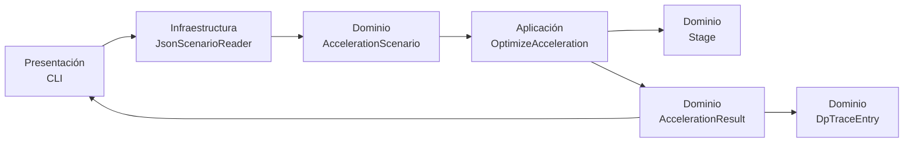
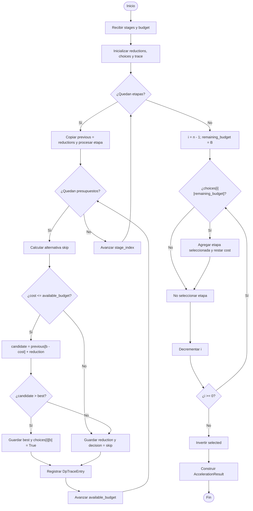

# MANUAL TÉCNICO OFICIAL

## Subproyecto 3: Ruta crítica con aceleración bajo presupuesto y cobertura mínima de auditoría

**Alcance de esta implementación:** primera entrega, Parte 1: aceleración óptima de una cadena secuencial bajo presupuesto. La cobertura de auditoría pertenece a otro componente del equipo y no es ejecutada por este módulo.

**Versión del proyecto:** `0.1.0`  
**Lenguaje:** Python `>= 3.10`  
**Entrada oficial:** `data/entrada_G3_mochila_20_nodos.json`

---

## 1. Visión general de la arquitectura del sistema

### 1.1 Responsabilidad del sistema

El sistema es un motor exacto de optimización para una cadena de etapas dispuestas en serie. Cada etapa tiene una duración normal, un costo de aceleración y una reducción de tiempo que se obtiene al acelerarla. Dado un presupuesto entero, el sistema selecciona el subconjunto de etapas que maximiza la reducción total sin exceder dicho presupuesto.

Como las etapas están en serie, todas pertenecen a la ruta crítica. Por ello, la duración de la cadena se calcula como:

$$
T_{base} = \sum_{i=1}^{n} t_i
$$

Si $A$ es el conjunto de etapas aceleradas, la duración resultante es:

$$
T(A) = T_{base} - \sum_{i \in A} d_i
$$

sujeto a:

$$
\sum_{i \in A} c_i \leq B.
$$

El problema se resuelve exactamente como una instancia de Mochila 0/1: cada etapa puede seleccionarse cero o una vez, su costo es el peso y su reducción de tiempo es el valor.

### 1.2 Patrón arquitectónico

El proyecto adopta **Clean Architecture** con separación entre dominio, aplicación, infraestructura y presentación:

- **Dominio:** contiene las entidades inmutables, invariantes y objetos de resultado. No depende de JSON, archivos, consola ni frameworks.
- **Aplicación:** contiene el caso de uso `OptimizeAcceleration`, que coordina la programación dinámica exacta.
- **Infraestructura:** contiene el adaptador `JsonScenarioReader`, que interpreta archivos JSON y construye objetos del dominio. También contiene la configuración de logging.
- **Presentación:** contiene la CLI, que configura la ejecución y serializa el resultado a JSON.

La dirección de dependencia apunta hacia el dominio. Así, cambiar el formato de entrada o la interfaz de usuario no obliga a modificar las entidades ni el algoritmo de optimización.

### 1.3 Diagrama de componentes



### 1.4 Flujo de ejecución

1. La CLI recibe opcionalmente una ruta JSON. Si no se entrega, usa `data/entrada_G3_mochila_20_nodos.json`.
2. `JsonScenarioReader` lee el archivo y extrae únicamente los datos necesarios para la Parte 1.
3. El adaptador construye un `AccelerationScenario` con etapas `Stage` y presupuesto.
4. La CLI entrega las etapas y el presupuesto a `OptimizeAcceleration.execute`.
5. El caso de uso calcula la solución óptima, reconstruye las decisiones y genera la traza.
6. La CLI serializa `AccelerationResult` como JSON.
7. El logger escribe eventos de ejecución en `logs/ruta_optima.log`.

---

## 2. Estructura del proyecto y módulos

```text
Proyecto/
├── data/
│   ├── entrada_G3_mochila_20_nodos.json
│   └── example_scenario.json
├── docs/
│   ├── MANUAL_TECNICO.md
│   ├── demostracion_np_dureza.md
│   └── manual_tecnico_grupo3.md
├── logs/
│   └── .gitkeep
├── resultados/
├── src/
│   └── ruta_optima/
│       ├── __init__.py
│       ├── application/
│       │   ├── __init__.py
│       │   ├── optimize_acceleration.py
│       │   └── ports.py
│       ├── domain/
│       │   ├── __init__.py
│       │   └── models.py
│       ├── infrastructure/
│       │   ├── __init__.py
│       │   ├── json_scenario.py
│       │   └── logging_config.py
│       └── presentation/
│           ├── __init__.py
│           └── cli.py
├── tests/
│   └── test_algorithms.py
├── .gitignore
├── pyproject.toml
└── README.md
```

### `src/ruta_optima/domain/models.py`

Define las entidades inmutables mediante `@dataclass(frozen=True)`:

- `Stage`: etapa individual y sus invariantes.
- `AccelerationScenario`: conjunto de etapas y presupuesto.
- `AcceleratedStage`: detalle de una etapa seleccionada.
- `AccelerationResult`: resultado consolidado de la optimización.
- `DpTraceEntry`: evidencia de cada estado calculado de la DP.

### `src/ruta_optima/application/optimize_acceleration.py`

Contiene el caso de uso `OptimizeAcceleration`. Implementa la solución exacta de Mochila 0/1 mediante un vector de reducciones, una matriz booleana de decisiones y una fase de reconstrucción.

### `src/ruta_optima/application/ports.py`

Define el puerto `ScenarioReader` mediante `Protocol`. La aplicación depende de este contrato conceptual y no del formato concreto de almacenamiento.

### `src/ruta_optima/infrastructure/json_scenario.py`

Implementa `JsonScenarioReader`, que traduce los dos formatos JSON admitidos a `AccelerationScenario`.

### `src/ruta_optima/infrastructure/logging_config.py`

Configura un logger rotativo con archivo de hasta 1 MB, tres respaldos, formato uniforme y salida de eventos `INFO` en consola.

### `src/ruta_optima/presentation/cli.py`

Expone el punto de entrada ejecutable, configura logging, carga el escenario mediante `JsonScenarioReader`, ejecuta el caso de uso y serializa el resultado.

---

## 3. Especificación detallada de dominio y clases

### 3.1 `Stage`

Entidad inmutable que representa una etapa de la cadena.

```python
@dataclass(frozen=True)
class Stage:
    name: str
    duration: int
    cost: int
    reduction: int
```

| Atributo | Tipo | Significado |
|---|---|---|
| `name` | `str` | Identificador de la etapa, por ejemplo `E01`. |
| `duration` | `int` | Duración normal $t_i$. |
| `cost` | `int` | Costo de aceleración $c_i$. |
| `reduction` | `int` | Reducción de tiempo $d_i$. |

`__post_init__` valida que el nombre no esté vacío, que los valores sean no negativos y que `reduction <= duration`.

### 3.2 `AccelerationScenario`

Objeto inmutable que representa una instancia del problema.

```python
@dataclass(frozen=True)
class AccelerationScenario:
    stages: tuple[Stage, ...]
    budget: int
```

| Atributo | Tipo | Significado |
|---|---|---|
| `stages` | `tuple[Stage, ...]` | Etapas ordenadas de la cadena. |
| `budget` | `int` | Presupuesto máximo disponible $B$. |

Su invariante exige `budget >= 0`.

### 3.3 `OptimizeAcceleration`

Caso de uso de aplicación que ejecuta la optimización.

```python
class OptimizeAcceleration:
    def execute(
        self,
        stages: list[Stage],
        budget: int,
    ) -> AccelerationResult:
        ...
```

El método:

1. Valida que el presupuesto no sea negativo.
2. Construye el vector `reductions` de tamaño `budget + 1`.
3. Procesa cada etapa y cada presupuesto disponible.
4. Registra las decisiones en `choices` y `dp_trace`.
5. Reconstruye las etapas seleccionadas desde el estado final.
6. Calcula y devuelve `AccelerationResult`.

### 3.4 `AcceleratedStage`

Objeto inmutable que documenta el detalle de una etapa seleccionada.

```python
@dataclass(frozen=True)
class AcceleratedStage:
    name: str
    cost: int
    reduction: int
```

Se utiliza en `accelerated_stage_details` para reportar el costo y la reducción de cada decisión final.

### 3.5 `AccelerationResult`

Objeto inmutable que consolida la solución.

```python
@dataclass(frozen=True)
class AccelerationResult:
    base_duration: int
    total_duration: int
    total_cost: int
    total_reduction: int
    accelerated_stages: tuple[str, ...]
    accelerated_stage_details: tuple[AcceleratedStage, ...]
    dp_trace: tuple[DpTraceEntry, ...]
```

| Atributo | Significado |
|---|---|
| `base_duration` | $sum_i t_i$, duración sin aceleración. |
| `total_duration` | Duración después de acelerar las etapas seleccionadas. |
| `total_cost` | Costo total utilizado. |
| `total_reduction` | Reducción total obtenida. |
| `accelerated_stages` | Identificadores de las etapas seleccionadas. |
| `accelerated_stage_details` | Costo y reducción individual de cada etapa seleccionada. |
| `dp_trace` | Estados calculados de la tabla DP. |

La relación de consistencia principal es:

$$
\texttt{total\_duration}
= \texttt{base\_duration} - \texttt{total\_reduction}.
$$

### 3.6 `DpTraceEntry`

Objeto inmutable de auditoría de la programación dinámica.

```python
@dataclass(frozen=True)
class DpTraceEntry:
    stage: str
    stage_index: int
    budget: int
    reduction: int
    decision: str
```

| Atributo | Significado |
|---|---|
| `stage` | Nombre de la etapa procesada. |
| `stage_index` | Índice de la etapa en la lista, comenzando en cero. |
| `budget` | Presupuesto disponible en el estado. |
| `reduction` | Mejor reducción calculada para ese estado. |
| `decision` | `take` si tomar la etapa mejora el estado; `skip` en caso contrario. |

### 3.7 Puerto `ScenarioReader`

La aplicación define el contrato de lectura sin acoplarse a JSON:

```python
class ScenarioReader(Protocol):
    def read(self, source: Path) -> AccelerationScenario:
        ...
```

`JsonScenarioReader` es el adaptador concreto que satisface este contrato.

---

## 4. Especificación de formatos de entrada y salida

### 4.1 Formato JSON genérico

El adaptador admite un formato compacto para pruebas y escenarios sintéticos:

```json
{
  "budget": 6,
  "stages": [
    {
      "name": "recepcion",
      "duration": 10,
      "cost": 3,
      "reduction": 4
    },
    {
      "name": "validacion",
      "duration": 8,
      "cost": 4,
      "reduction": 5
    }
  ]
}
```

El campo `stages` se convierte directamente con `Stage(**stage)` y `budget` se convierte en el presupuesto del escenario.

### 4.2 Formato oficial de la profesora

La entrada oficial contiene información adicional para auditoría. Para esta Parte 1, `JsonScenarioReader` utiliza únicamente:

- `parametros.presupuesto_aceleracion_B`.
- `etapas[].id`.
- `etapas[].duracion_normal`.
- `etapas[].costo_aceleracion`.
- `etapas[].reduccion_tiempo_si_acelera`.

Los campos `flujo`, `categorias_riesgo`, `riesgos_cubiertos_auditoria_completa` y `variaciones_auditoria` no son consumidos por el optimizador de aceleración.

Ejemplo representativo:

```json
{
  "parametros": {
    "numero_etapas": 20,
    "presupuesto_aceleracion_B": 72,
    "presupuesto_conjunto_aceleracion_y_auditoria": 100,
    "numero_categorias_riesgo": 12
  },
  "etapas": [
    {
      "id": "E01",
      "duracion_normal": 18,
      "costo_aceleracion": 7,
      "reduccion_tiempo_si_acelera": 5,
      "riesgos_cubiertos_auditoria_completa": ["R01", "R02"],
      "variaciones_auditoria": []
    },
    {
      "id": "E02",
      "duracion_normal": 24,
      "costo_aceleracion": 12,
      "reduccion_tiempo_si_acelera": 9,
      "riesgos_cubiertos_auditoria_completa": ["R02", "R04"],
      "variaciones_auditoria": []
    }
  ]
}
```

En el archivo oficial real, la lista contiene 20 etapas. El adaptador produce objetos equivalentes a:

```python
Stage(
    name="E01",
    duration=18,
    cost=7,
    reduction=5,
)
```

y un escenario con `budget=72`.

### 4.3 Salida JSON

La CLI ejecuta:

```python
print(json.dumps(asdict(result), indent=2, ensure_ascii=True))
```

Por tanto, la salida tiene esta estructura:

```json
{
  "base_duration": 501,
  "total_duration": 446,
  "total_cost": 72,
  "total_reduction": 55,
  "accelerated_stages": [
    "E02",
    "E03",
    "E04",
    "E06",
    "E08",
    "E12"
  ],
  "accelerated_stage_details": [
    {"name": "E02", "cost": 12, "reduction": 9},
    {"name": "E03", "cost": 5, "reduction": 4},
    {"name": "E04", "cost": 16, "reduction": 12},
    {"name": "E06", "cost": 13, "reduction": 10},
    {"name": "E08", "cost": 17, "reduction": 13},
    {"name": "E12", "cost": 9, "reduction": 7}
  ],
  "dp_trace": [
    {
      "stage": "E01",
      "stage_index": 0,
      "budget": 0,
      "reduction": 0,
      "decision": "skip"
    }
  ]
}
```

Para la entrada oficial de 20 etapas y presupuesto 72, la traza contiene:

$$
20 \times (72+1) = 1460
$$

objetos `DpTraceEntry`.

### 4.4 Significado de la traza

Cada elemento de `dp_trace` representa una celda procesada. La pareja `(stage_index, budget)` identifica el estado. `reduction` es el valor óptimo calculado hasta esa etapa y presupuesto. `decision` indica si la alternativa de tomar la etapa produjo una mejora estricta (`take`) o si se conservó la solución anterior (`skip`).

La traza de logging también registra estos estados en nivel `DEBUG` como:

```text
2026-11-04 16:00:06 | DEBUG    | ruta_optima.application.optimize_acceleration | DP[20][72] = 55 (skip)
```

---

## 5. Diseño algorítmico y lógica de programación dinámica

### 5.1 Formulación como Mochila 0/1

Cada etapa es un objeto seleccionable como máximo una vez:

| Mochila 0/1 | Dominio de aceleración |
|---|---|
| Peso $w_i$ | Costo $c_i$ |
| Valor $v_i$ | Reducción $d_i$ |
| Capacidad $W$ | Presupuesto $B$ |
| Valor máximo | Reducción total máxima |

La tabla conceptual es:

$$
DP[i][b] = \text{máxima reducción usando las primeras } i \text{ etapas con presupuesto } b.
$$

La implementación optimiza memoria para los valores numéricos usando:

```python
reductions = [0] * (budget + 1)
```

Este vector contiene la fila actual de la tabla. Antes de procesar cada etapa se crea:

```python
previous = reductions[:]
```

La copia evita que la misma etapa sea reutilizada durante su propio procesamiento, preservando la semántica 0/1.

Para reconstruir la solución se conserva además:

```python
choices = [[False] * (budget + 1) for _ in stages]
```

La matriz tiene $n \times (B+1)$ posiciones booleanas.

### 5.2 Proceso de transición

Para cada etapa y cada presupuesto disponible `available_budget`:

1. Se considera `skip`, con valor `previous[available_budget]`.
2. Si `stage.cost <= available_budget`, se considera `take`:

```python
candidate = previous[available_budget - stage.cost] + stage.reduction
```

3. Si `candidate > best`, se actualiza el estado:

```python
best = candidate
decision = "take"
choices[stage_index][available_budget] = True
```

4. Si no mejora el estado, la decisión permanece como `skip`.
5. El valor se guarda en `reductions[available_budget]`.
6. Se crea un `DpTraceEntry` con la decisión y el valor resultante.

La recurrencia matemática equivalente es:

$$
DP[i][b] =
\begin{cases}
\max\left(DP[i-1][b], DP[i-1][b-c_i]+d_i\right), & c_i \leq b,\\
DP[i-1][b], & c_i > b.
\end{cases}
$$

El código conserva la primera alternativa en caso de empate, porque solo cambia a `take` cuando `candidate > best`. Esto proporciona reconstrucciones deterministas.

### 5.3 Reconstrucción mediante backtracking

Después de procesar todas las etapas, el estado óptimo se encuentra en:

```python
reductions[budget]
```

El algoritmo inicia con:

```python
remaining_budget = budget
```

y recorre las etapas desde `len(stages) - 1` hasta `0`:

```python
for stage_index in range(len(stages) - 1, -1, -1):
    stage = stages[stage_index]
    if choices[stage_index][remaining_budget]:
        selected.append(stage.name)
        remaining_budget -= stage.cost
```

Si la matriz indica `True`, la etapa pertenece a una solución óptima para ese estado y se resta su costo. Finalmente, la lista se invierte para recuperar el orden original de la cadena.

### 5.4 Diagrama de flujo



---

## 6. Análisis de complejidad computacional y memoria

### 6.1 Complejidad temporal

Se procesan $n$ etapas y $B+1$ presupuestos:

$$
 n(B+1) = \Theta(nB)
$$

Cada celda ejecuta un número constante de operaciones: lectura, comparación, suma condicional y escritura. La generación de cada `DpTraceEntry` también es constante por estado. Por tanto:

$$
T(n,B) = \Theta(nB).
$$

El backtracking recorre una vez las etapas y cuesta $O(n)$, que queda dominado por $O(nB)$ cuando $B \geq 1$.

### 6.2 Complejidad espacial

La matriz de decisiones ocupa:

$$
O(nB).
$$

El vector `reductions` ocupa $O(B)$ y la copia temporal `previous` también ocupa $O(B)$. La traza completa contiene un elemento por estado y, por tanto, añade:

$$
O(nB)
$$

objetos de auditoría. En conjunto, la implementación usa:

$$
S(n,B) = O(nB) + O(B) + O(nB) = O(nB).
$$

La clasificación solicitada puede expresarse como:

- `choices`: $O(nB)$.
- `reductions`: $O(B)$.
- `previous`: $O(B)$.
- `dp_trace`: $O(nB)$.
- Total asintótico: $O(nB)$.

Aunque los valores DP se almacenan en un vector de $O(B)$, la matriz `choices` y la traza son necesarias para ofrecer reconstrucción y evidencia detallada.

### 6.3 Escalabilidad y carácter pseudo-polinomial

La complejidad es polinomial en el valor numérico del presupuesto, pero no necesariamente en el número de bits que representa $B$. Si $k$ es el número de bits de $B$:

$$
 k = \left\lceil\log_2(B+1)\right\rceil,
 \qquad B = \Theta(2^k).
$$

Entonces:

$$
O(nB) = O(n2^k).
$$

En la práctica:

- Aumentar el número de etapas $n$ aumenta linealmente el trabajo y la memoria.
- Aumentar el presupuesto $B$ aumenta linealmente el número de estados por etapa.
- Un presupuesto astronómico puede hacer inviable la matriz `choices`, aunque $n$ sea pequeño.
- La traza completa puede generar archivos de log grandes; el logger utiliza rotación para limitar el tamaño de los archivos.

---

## 7. Guía de instalación, configuración y ejecución

### 7.1 Requisitos de entorno

- Python `3.10` o superior.
- Git.
- Sistema operativo Linux, macOS o Windows con una terminal compatible.
- No se requieren dependencias externas de runtime: la solución usa la biblioteca estándar de Python.

### 7.2 Clonar y configurar

Desde el repositorio remoto:

```bash
git clone <URL_DEL_REPOSITORIO>
cd Proyecto
```

Crear y activar un entorno virtual:

```bash
python3 -m venv .venv
source .venv/bin/activate
```

En Windows PowerShell:

```powershell
py -m venv .venv
.venv\Scripts\Activate.ps1
```

Instalar el proyecto en modo editable:

```bash
python -m pip install --upgrade pip
python -m pip install -e .
```

El `pyproject.toml` declara la versión mínima de Python y el descubrimiento del paquete `src/ruta_optima`.

### 7.3 Ejecutar la entrada oficial

Desde la raíz del proyecto, ejecutar:

```bash
python -m ruta_optima.presentation.cli
```

La aplicación carga automáticamente:

```text
data/entrada_G3_mochila_20_nodos.json
```

Para especificar el archivo explícitamente:

```bash
python -m ruta_optima.presentation.cli data/entrada_G3_mochila_20_nodos.json
```

Para guardar la salida JSON como evidencia de la entrega:

```bash
mkdir -p resultados
python -m ruta_optima.presentation.cli \
  data/entrada_G3_mochila_20_nodos.json \
  > resultados/entrada_G3_parte1.json
```

La salida oficial validada contiene:

```text
Duración base:       501
Duración final:      446
Reducción total:      55
Costo utilizado:      72
Etapas aceleradas: E02, E03, E04, E06, E08, E12
Estados DP:         1460
```

La selección usa todo el presupuesto y respeta las restricciones del escenario.

### 7.4 Configurar logs

Por defecto, el logger escribe en:

```text
logs/ruta_optima.log
```

Para utilizar otra carpeta:

```bash
python -m ruta_optima.presentation.cli \
  --log-dir resultados/logs
```

El archivo utiliza el formato:

```text
YYYY-MM-DD HH:MM:SS | LEVEL | MODULE | MESSAGE
```

Se registran eventos `INFO` en consola y archivo, y estados detallados de la DP en nivel `DEBUG` dentro del archivo. El archivo rota al alcanzar 1 MB y conserva hasta tres copias anteriores.

### 7.5 Ejecutar pruebas

El comando oficial incluido en el proyecto es:

```bash
python -m unittest discover -s tests -v
```

También puede utilizarse `pytest` si se instala como herramienta de desarrollo:

```bash
python -m pip install pytest
python -m pytest -q
```

Las pruebas cubren la solución óptima en una instancia pequeña y la carga de la entrada oficial G3.

---

## 8. Limitaciones técnicas y consideraciones futuras

### 8.1 Limitaciones actuales

1. **Cadena secuencial pura:** la duración se calcula como la suma de todas las etapas. No se modelan todavía ramas paralelas, dependencias alternativas ni rutas múltiples.
2. **Presupuesto entero:** la DP indexa el presupuesto desde `0` hasta `B`, por lo que `budget` debe ser un entero no negativo.
3. **Crecimiento pseudo-polinomial:** la matriz `choices` y la traza crecen como $O(nB)$. Presupuestos astronómicos, por ejemplo $B > 10^7$, pueden hacer que el consumo de memoria y tiempo sea inaceptable.
4. **Trazabilidad completa:** registrar un `DpTraceEntry` por estado es útil para la entrega y auditoría, pero incrementa el volumen de memoria y logging.
5. **Empates:** cuando `take` y `skip` producen la misma reducción, la implementación conserva `skip`. La solución sigue siendo óptima, aunque puede existir otra selección equivalente.
6. **Validación de entrada:** se validan las invariantes del dominio, pero el adaptador no implementa todavía un esquema JSON formal con mensajes de error especializados para todos los campos faltantes o tipos inválidos.
7. **Cobertura no incluida:** los campos de auditoría del JSON oficial se ignoran en esta Parte 1. La selección de auditorías debe implementarse como otro caso de uso.

### 8.2 Extensión hacia DAG y etapas en paralelo

Para soportar el requisito futuro de un flujo general con etapas en paralelo, la arquitectura permite agregar nuevos modelos y casos de uso sin modificar `Stage` ni `OptimizeAcceleration`:

1. Crear entidades de dominio para nodos y aristas de un DAG.
2. Incorporar un `GraphScenario` separado de `AccelerationScenario`.
3. Añadir un adaptador de entrada que construya el grafo desde JSON.
4. Implementar un caso de uso de ruta crítica basado en orden topológico.
5. Calcular primero la ruta más larga del DAG en $O(n+m)$, donde $m$ es el número de aristas.
6. Modelar la aceleración sobre la ruta crítica mediante un componente de aplicación específico.

El puerto de lectura permite reutilizar adaptadores o agregar uno nuevo sin acoplar la aplicación al formato de almacenamiento.

### 8.3 Extensión hacia auditoría de riesgos

La Parte 2 debe incorporarse como un módulo independiente, por ejemplo:

```text
application/
├── optimize_acceleration.py
└── select_audits.py

domain/
├── models.py
└── audit_models.py
```

El nuevo módulo podría incluir:

- `RiskCategory` y `AuditCandidate` en el dominio.
- Un puerto de lectura de riesgos.
- Un caso de uso de cobertura de conjuntos.
- Una variante ponderada por costo.
- Un resultado y una traza propios.

La combinación futura de aceleración y auditoría bajo presupuesto conjunto debe tratarse como otro problema de optimización y no mezclarse directamente dentro de `OptimizeAcceleration`. Esta separación conserva la responsabilidad única y permite probar cada problema de manera aislada antes de introducir una coordinación conjunta.

### 8.4 Evolución de rendimiento

Si los presupuestos son demasiado grandes, pueden evaluarse estrategias futuras:

- eliminar la traza completa en producción y mantenerla solo en modo evidencia;
- usar una reconstrucción con menor memoria si solo se requiere la solución final;
- aplicar compresión o almacenamiento por bloques de la matriz de decisiones;
- explorar algoritmos aproximados o esquemas FPTAS para Mochila 0/1;
- paralelizar la generación de instancias experimentales, sin alterar la exactitud del caso de uso principal.

Estas optimizaciones deben conservar la interfaz de dominio y validarse contra la solución exacta en instancias pequeñas.

---

## 9. Criterios de reproducibilidad para la primera entrega

Para reproducir la evidencia de la Parte 1:

1. Usar el archivo oficial sin modificar la lógica del algoritmo.
2. Ejecutar `python -m ruta_optima.presentation.cli` desde la raíz.
3. Conservar la salida JSON en `resultados/entrada_G3_parte1.json`.
4. Conservar `logs/ruta_optima.log` como evidencia de lectura, estados y resultado.
5. Ejecutar `python -m unittest discover -s tests -v`.
6. Reportar por caso: duración base, duración final, costo, reducción, etapas aceleradas, tiempo de ejecución y cantidad de estados de la traza.

La implementación actual reproduce para la entrada oficial:

$$
T_{base}=501,
\qquad
T_{final}=446,
\qquad
D=55,
\qquad
C=72.
$$

La solución selecciona las etapas:

$$
\{E02,E03,E04,E06,E08,E12\}.
$$

Estos valores deben mantenerse sincronizados entre el código, el informe técnico, el manual y la evidencia generada.
