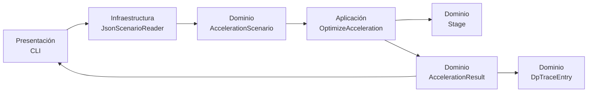
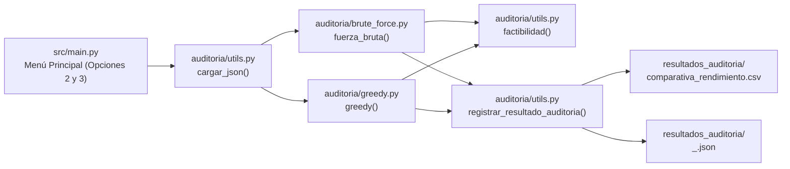
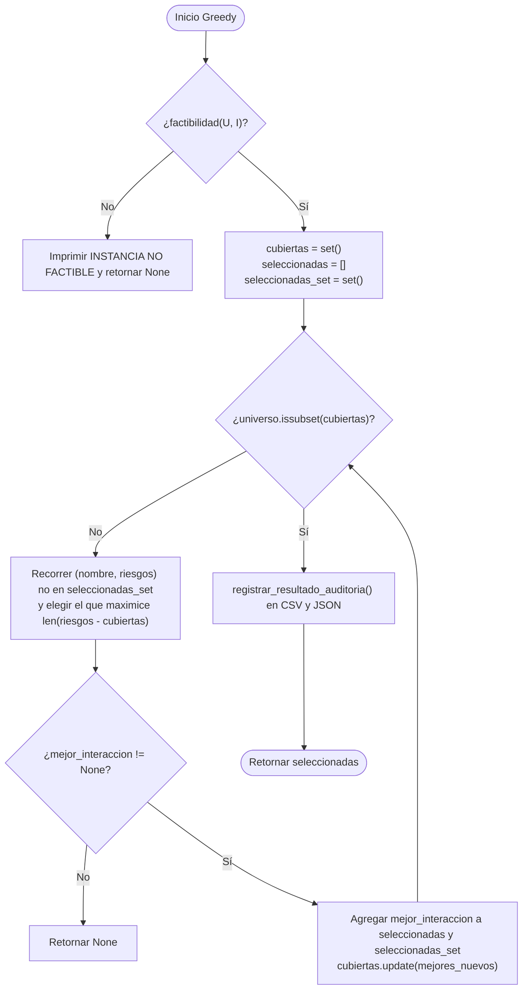

# MANUAL TÉCNICO OFICIAL

## Subproyecto 3: Ruta crítica con aceleración bajo presupuesto y cobertura mínima de auditoría

**Alcance de esta implementación:** primera entrega, Parte 1: aceleración óptima de una cadena secuencial bajo presupuesto. La cobertura de auditoría pertenece a otro componente del equipo y no es ejecutada por este módulo.

**Versión del proyecto:** `0.1.0`  
**Lenguaje:** Python `>= 3.10`  
**Entrada oficial:** `data/entrada_G3_mochila_20_nodos.json`

---

## 1. Visión general de la arquitectura del sistema

### 1.1 Responsabilidad del sistema

El sistema es un motor exacto de optimización para una cadena de etapas dispuestas en serie. Cada etapa tiene una duración normal, un costo de aceleración y una reducción de tiempo que se obtiene al acelerarla. Dado un presupuesto entero, el sistema selecciona el subconjunto de etapas que maximiza la reducción total sin exceder dicho presupuesto.

Como las etapas están en serie, todas pertenecen a la ruta crítica. Por ello, la duración de la cadena se calcula como:

$$
T_{base} = \sum_{i=1}^{n} t_i
$$

Si $A$ es el conjunto de etapas aceleradas, la duración resultante es:

$$
T(A) = T_{base} - \sum_{i \in A} d_i
$$

sujeto a:

$$
\sum_{i \in A} c_i \leq B.
$$

El problema se resuelve exactamente como una instancia de Mochila 0/1: cada etapa puede seleccionarse cero o una vez, su costo es el peso y su reducción de tiempo es el valor.

### 1.2 Patrón arquitectónico

El proyecto adopta **Clean Architecture** con separación entre dominio, aplicación, infraestructura y presentación:

- **Dominio:** contiene las entidades inmutables, invariantes y objetos de resultado. No depende de JSON, archivos, consola ni frameworks.
- **Aplicación:** contiene el caso de uso `OptimizeAcceleration`, que coordina la programación dinámica exacta.
- **Infraestructura:** contiene el adaptador `JsonScenarioReader`, que interpreta archivos JSON y construye objetos del dominio. También contiene la configuración de logging.
- **Presentación:** contiene la CLI, que configura la ejecución y serializa el resultado a JSON.

La dirección de dependencia apunta hacia el dominio. Así, cambiar el formato de entrada o la interfaz de usuario no obliga a modificar las entidades ni el algoritmo de optimización.

### 1.3 Diagrama de componentes



### 1.4 Flujo de ejecución

1. La CLI recibe opcionalmente una ruta JSON. Si no se entrega, usa `data/entrada_G3_mochila_20_nodos.json`.
2. `JsonScenarioReader` lee el archivo y extrae únicamente los datos necesarios para la Parte 1.
3. El adaptador construye un `AccelerationScenario` con etapas `Stage` y presupuesto.
4. La CLI entrega las etapas y el presupuesto a `OptimizeAcceleration.execute`.
5. El caso de uso calcula la solución óptima, reconstruye las decisiones y genera la traza.
6. La CLI serializa `AccelerationResult` como JSON.
7. El logger escribe eventos de ejecución en `logs/ruta_optima.log`.

---

## 2. Estructura del proyecto y módulos

```text
Proyecto/
├── data/
│   └── entrada_G3_mochila_20_nodos.json
├── docs/
│   ├── MANUAL_TECNICO.md
│   ├── demostracion_np_dureza.md
│   └── manual_tecnico_grupo3.md
├── src/
│   └── ruta_optima/
│       ├── __init__.py
│       ├── constants/
│       │   └── base.py
│       ├── application/
│       │   ├── optimize_acceleration.py
│       │   └── ports.py
│       ├── domain/
│       │   ├── accelerated_stage.py
│       │   ├── acceleration_result.py
│       │   ├── acceleration_scenario.py
│       │   ├── dp_trace_entry.py
│       │   └── stage.py
│       ├── infrastructure/
│       │   ├── json_scenario.py
│       │   └── logging_config.py
│       └── main.py
├── .gitignore
├── pyproject.toml
└── README.md
```

### `src/ruta_optima/domain/`

Define las entidades inmutables mediante `@dataclass(frozen=True)`:

- `stage.py`: `Stage`, etapa individual y sus invariantes.
- `acceleration_scenario.py`: `AccelerationScenario`, conjunto de etapas y presupuesto.
- `accelerated_stage.py`: `AcceleratedStage`, detalle de una etapa seleccionada.
- `acceleration_result.py`: `AccelerationResult`, resultado consolidado de la optimización.
- `dp_trace_entry.py`: `DpTraceEntry`, evidencia de cada estado calculado de la DP.

### `src/ruta_optima/application/optimize_acceleration.py`

Contiene el caso de uso `OptimizeAcceleration`. Implementa la solución exacta de Mochila 0/1 mediante un vector de reducciones, una matriz booleana de decisiones y una fase de reconstrucción.

### `src/ruta_optima/application/ports.py`

Define los puertos `ScenarioReader` y `LoggerPort` mediante `Protocol`. La aplicación depende de estos contratos y no del formato concreto de almacenamiento ni de la implementación concreta del logging.

### `src/ruta_optima/constants/base.py`

Contiene las constantes globales de la aplicación: escenario oficial por defecto, directorio y nivel de logging, nombre del logger, formato de fecha y mensaje, y parámetros de rotación.

### `src/ruta_optima/infrastructure/json_scenario.py`

Implementa `JsonScenarioReader`, que traduce la entrada oficial de la profesora `entrada_G3_mochila_20_nodos.json` a `AccelerationScenario`.

### `src/ruta_optima/infrastructure/logging_config.py`

Configura `SafeLogger`, que escribe un archivo histórico en `logs/DD_MM_YYYY/HHhrs/`, actualiza `logs/last_ruta_optima.log` y muestra eventos `INFO` coloreados en consola cuando `colorama` está disponible. Si la dependencia no está instalada, utiliza salida sin colores.

### `src/main.py`

Es el punto de entrada principal: configura logging, carga el escenario mediante `JsonScenarioReader`, ejecuta el caso de uso y serializa el resultado.

---

## 3. Especificación detallada de dominio y clases

### 3.1 `Stage`

Entidad inmutable que representa una etapa de la cadena.

```python
@dataclass(frozen=True)
class Stage:
    name: str
    duration: int
    cost: int
    reduction: int
```

| Atributo | Tipo | Significado |
|---|---|---|
| `name` | `str` | Identificador de la etapa, por ejemplo `E01`. |
| `duration` | `int` | Duración normal $t_i$. |
| `cost` | `int` | Costo de aceleración $c_i$. |
| `reduction` | `int` | Reducción de tiempo $d_i$. |

`__post_init__` valida que el nombre no esté vacío, que los valores sean no negativos y que `reduction <= duration`.

### 3.2 `AccelerationScenario`

Objeto inmutable que representa una instancia del problema.

```python
@dataclass(frozen=True)
class AccelerationScenario:
    stages: tuple[Stage, ...]
    budget: int
```

| Atributo | Tipo | Significado |
|---|---|---|
| `stages` | `tuple[Stage, ...]` | Etapas ordenadas de la cadena. |
| `budget` | `int` | Presupuesto máximo disponible $B$. |

Su invariante exige `budget >= 0`.

### 3.3 `OptimizeAcceleration`

## 7. Guía de instalación y uso

La instalación, configuración, ejecución de la CLI, generación de evidencia y consulta de logs están documentadas en el [README.md](../README.md), que funciona como manual de usuario del proyecto.
- `etapas[].duracion_normal`.
- `etapas[].costo_aceleracion`.
- `etapas[].reduccion_tiempo_si_acelera`.

Los campos `flujo`, `categorias_riesgo`, `riesgos_cubiertos_auditoria_completa` y `variaciones_auditoria` no son consumidos por el optimizador de aceleración.

Ejemplo representativo:

```json
{
  "parametros": {
    "numero_etapas": 20,
    "presupuesto_aceleracion_B": 72,
    "presupuesto_conjunto_aceleracion_y_auditoria": 100,
    "numero_categorias_riesgo": 12
  },
  "etapas": [
    {
      "id": "E01",
      "duracion_normal": 18,
      "costo_aceleracion": 7,
      "reduccion_tiempo_si_acelera": 5,
      "riesgos_cubiertos_auditoria_completa": ["R01", "R02"],
      "variaciones_auditoria": []
    },
    {
      "id": "E02",
      "duracion_normal": 24,
      "costo_aceleracion": 12,
      "reduccion_tiempo_si_acelera": 9,
      "riesgos_cubiertos_auditoria_completa": ["R02", "R04"],
      "variaciones_auditoria": []
    }
  ]
}
```

En el archivo oficial real, la lista contiene 20 etapas. El adaptador produce objetos equivalentes a:

```python
Stage(
    name="E01",
    duration=18,
    cost=7,
    reduction=5,
)
```

y un escenario con `budget=72`.

### 4.2 Salida JSON

La CLI ejecuta:

```python
print(json.dumps(asdict(result), indent=2, ensure_ascii=True))
```

Por tanto, la salida tiene esta estructura:

```json
{
  "base_duration": 501,
  "total_duration": 446,
  "total_cost": 72,
  "total_reduction": 55,
  "accelerated_stages": [
    "E02",
    "E03",
    "E04",
    "E06",
    "E08",
    "E12"
  ],
  "accelerated_stage_details": [
    {"name": "E02", "cost": 12, "reduction": 9},
    {"name": "E03", "cost": 5, "reduction": 4},
    {"name": "E04", "cost": 16, "reduction": 12},
    {"name": "E06", "cost": 13, "reduction": 10},
    {"name": "E08", "cost": 17, "reduction": 13},
    {"name": "E12", "cost": 9, "reduction": 7}
  ],
  "dp_trace": [
    {
      "stage": "E01",
      "stage_index": 0,
      "budget": 0,
      "reduction": 0,
      "decision": "skip"
    }
  ]
}
```

Para la entrada oficial de 20 etapas y presupuesto 72, la traza contiene:

$$
20 \times (72+1) = 1460
$$

objetos `DpTraceEntry`.

### 4.3 Significado de la traza

Cada elemento de `dp_trace` representa una celda procesada. La pareja `(stage_index, budget)` identifica el estado. `reduction` es el valor óptimo calculado hasta esa etapa y presupuesto. `decision` indica si la alternativa de tomar la etapa produjo una mejora estricta (`take`) o si se conservó la solución anterior (`skip`).

La traza de logging también registra estos estados en nivel `DEBUG` como:

```text
2026-11-04 16:00:06 | DEBUG    | ruta_optima.application.optimize_acceleration | DP[20][72] = 55 (skip)
```

---

## 5. Diseño algorítmico y lógica de programación dinámica

### 5.1 Formulación como Mochila 0/1

Cada etapa es un objeto seleccionable como máximo una vez:

| Mochila 0/1 | Dominio de aceleración |
|---|---|
| Peso $w_i$ | Costo $c_i$ |
| Valor $v_i$ | Reducción $d_i$ |
| Capacidad $W$ | Presupuesto $B$ |
| Valor máximo | Reducción total máxima |

La tabla conceptual es:

$$
DP[i][b] = \text{máxima reducción usando las primeras } i \text{ etapas con presupuesto } b.
$$

La implementación optimiza memoria para los valores numéricos usando:

```python
reductions = [0] * (budget + 1)
```

Este vector contiene la fila actual de la tabla. Antes de procesar cada etapa se crea:

```python
previous = reductions[:]
```

La copia evita que la misma etapa sea reutilizada durante su propio procesamiento, preservando la semántica 0/1.

Para reconstruir la solución se conserva además:

```python
choices = [[False] * (budget + 1) for _ in stages]
```

La matriz tiene $n \times (B+1)$ posiciones booleanas.

### 5.2 Proceso de transición

Para cada etapa y cada presupuesto disponible `available_budget`:

1. Se considera `skip`, con valor `previous[available_budget]`.
2. Si `stage.cost <= available_budget`, se considera `take`:

```python
candidate = previous[available_budget - stage.cost] + stage.reduction
```

3. Si `candidate > best`, se actualiza el estado:

```python
best = candidate
decision = "take"
choices[stage_index][available_budget] = True
```

4. Si no mejora el estado, la decisión permanece como `skip`.
5. El valor se guarda en `reductions[available_budget]`.
6. Se crea un `DpTraceEntry` con la decisión y el valor resultante.

La recurrencia matemática equivalente es:

$$
DP[i][b] =
\begin{cases}
\max\left(DP[i-1][b], DP[i-1][b-c_i]+d_i\right), & c_i \leq b,\\
DP[i-1][b], & c_i > b.
\end{cases}
$$

El código conserva la primera alternativa en caso de empate, porque solo cambia a `take` cuando `candidate > best`. Esto proporciona reconstrucciones deterministas.

### 5.3 Reconstrucción mediante backtracking

Después de procesar todas las etapas, el estado óptimo se encuentra en:

```python
reductions[budget]
```

El algoritmo inicia con:

```python
remaining_budget = budget
```

y recorre las etapas desde `len(stages) - 1` hasta `0`:

```python
for stage_index in range(len(stages) - 1, -1, -1):
    stage = stages[stage_index]
    if choices[stage_index][remaining_budget]:
        selected.append(stage.name)
        remaining_budget -= stage.cost
```

Si la matriz indica `True`, la etapa pertenece a una solución óptima para ese estado y se resta su costo. Finalmente, la lista se invierte para recuperar el orden original de la cadena.

### 5.4 Diagrama de flujo


---

## 6. Análisis de complejidad computacional y memoria

### 6.1 Complejidad temporal

Se procesan $n$ etapas y $B+1$ presupuestos:

$$
 n(B+1) = \Theta(nB)
$$

Cada celda ejecuta un número constante de operaciones: lectura, comparación, suma condicional y escritura. La generación de cada `DpTraceEntry` también es constante por estado. Por tanto:

$$
T(n,B) = \Theta(nB).
$$

El backtracking recorre una vez las etapas y cuesta $O(n)$, que queda dominado por $O(nB)$ cuando $B \geq 1$.

### 6.2 Complejidad espacial

La matriz de decisiones ocupa:

$$
O(nB).
$$

El vector `reductions` ocupa $O(B)$ y la copia temporal `previous` también ocupa $O(B)$. La traza completa contiene un elemento por estado y, por tanto, añade:

$$
O(nB)
$$

objetos de auditoría. En conjunto, la implementación usa:

$$
S(n,B) = O(nB) + O(B) + O(nB) = O(nB).
$$

La clasificación solicitada puede expresarse como:

- `choices`: $O(nB)$.
- `reductions`: $O(B)$.
- `previous`: $O(B)$.
- `dp_trace`: $O(nB)$.
- Total asintótico: $O(nB)$.

Aunque los valores DP se almacenan en un vector de $O(B)$, la matriz `choices` y la traza son necesarias para ofrecer reconstrucción y evidencia detallada.

### 6.3 Escalabilidad y carácter pseudo-polinomial

La complejidad es polinomial en el valor numérico del presupuesto, pero no necesariamente en el número de bits que representa $B$. Si $k$ es el número de bits de $B$:

$$
 k = \left\lceil\log_2(B+1)\right\rceil,
 \qquad B = \Theta(2^k).
$$

Entonces:

$$
O(nB) = O(n2^k).
$$

En la práctica:

- Aumentar el número de etapas $n$ aumenta linealmente el trabajo y la memoria.
- Aumentar el presupuesto $B$ aumenta linealmente el número de estados por etapa.
- Un presupuesto astronómico puede hacer inviable la matriz `choices`, aunque $n$ sea pequeño.
- La traza completa puede generar archivos de log grandes; el logger utiliza rotación para limitar el tamaño de los archivos.

---

## 7. Guía de instalación, configuración y ejecución

### 7.1 Requisitos de entorno

- Python `3.10` o superior.
- Git.
- Sistema operativo Linux, macOS o Windows con una terminal compatible.
- No se requieren dependencias externas de runtime: la solución usa la biblioteca estándar de Python.

### 7.2 Clonar y configurar

Desde el repositorio remoto:

```bash
git clone <URL_DEL_REPOSITORIO>
cd Proyecto
```

Crear y activar un entorno virtual:

```bash
python3 -m venv .venv
source .venv/bin/activate
```

En Windows PowerShell:

```powershell
py -m venv .venv
.venv\Scripts\Activate.ps1
```

Instalar el proyecto en modo editable:

```bash
python -m pip install --upgrade pip
python -m pip install -e .
```

El `pyproject.toml` declara la versión mínima de Python y el descubrimiento del paquete `src/ruta_optima`.

### 7.3 Ejecutar la entrada oficial

Desde la raíz del proyecto, ejecutar:

```bash
python -m ruta_optima.presentation.cli
```

La aplicación carga automáticamente:

```text
data/entrada_G3_mochila_20_nodos.json
```

Para especificar el archivo explícitamente:

```bash
python -m ruta_optima.presentation.cli data/entrada_G3_mochila_20_nodos.json
```

Para guardar la salida JSON como evidencia de la entrega:

```bash
mkdir -p resultados
python -m ruta_optima.presentation.cli \
  data/entrada_G3_mochila_20_nodos.json \
  > resultados/entrada_G3_parte1.json
```

La salida oficial validada contiene:

```text
Duración base:       501
Duración final:      446
Reducción total:      55
Costo utilizado:      72
Etapas aceleradas: E02, E03, E04, E06, E08, E12
Estados DP:         1460
```

La ejecución normal de la CLI muestra únicamente este resumen y el tiempo de ejecución. La traza completa se conserva en los archivos de logging. Para imprimirla explícitamente en la consola se puede usar:

```bash
python -m ruta_optima.presentation.cli --full-output
```

La selección usa todo el presupuesto y respeta las restricciones del escenario.

### 7.4 Configurar logs

Por defecto, el logger escribe en:

```text
logs/DD_MM_YYYY/HHhrs/ruta_optima.log
logs/last_ruta_optima.log
```

Para utilizar otra carpeta:

```bash
python -m ruta_optima.presentation.cli \
  --log-dir resultados/logs
```

El archivo utiliza el formato:

```text
YYYY-MM-DD HH:MM:SS | LEVEL | MODULE | MESSAGE
```

Se registran eventos `INFO` en consola y archivo, y estados detallados de la DP en nivel `DEBUG` dentro del archivo. La consola usa colores cuando `colorama` está disponible; los archivos permanecen sin códigos de color. La salida de logs usa `stderr` para mantener limpio el JSON que la CLI imprime por `stdout`.

---

## 8. Limitaciones técnicas y consideraciones futuras

### 8.1 Limitaciones actuales

1. **Cadena secuencial pura:** la duración se calcula como la suma de todas las etapas. No se modelan todavía ramas paralelas, dependencias alternativas ni rutas múltiples.
2. **Presupuesto entero:** la DP indexa el presupuesto desde `0` hasta `B`, por lo que `budget` debe ser un entero no negativo.
3. **Crecimiento pseudo-polinomial:** la matriz `choices` y la traza crecen como $O(nB)$. Presupuestos astronómicos, por ejemplo $B > 10^7$, pueden hacer que el consumo de memoria y tiempo sea inaceptable.
4. **Trazabilidad completa:** registrar un `DpTraceEntry` por estado es útil para la entrega y auditoría, pero incrementa el volumen de memoria y logging.
5. **Empates:** cuando `take` y `skip` producen la misma reducción, la implementación conserva `skip`. La solución sigue siendo óptima, aunque puede existir otra selección equivalente.
6. **Validación de entrada:** se validan las invariantes del dominio, pero el adaptador no implementa todavía un esquema JSON formal con mensajes de error especializados para todos los campos faltantes o tipos inválidos.
7. **Cobertura no incluida:** los campos de auditoría del JSON oficial se ignoran en esta Parte 1. La selección de auditorías debe implementarse como otro caso de uso.

### 8.2 Extensión hacia DAG y etapas en paralelo

Para soportar el requisito futuro de un flujo general con etapas en paralelo, la arquitectura permite agregar nuevos modelos y casos de uso sin modificar `Stage` ni `OptimizeAcceleration`:

1. Crear entidades de dominio para nodos y aristas de un DAG.
2. Incorporar un `GraphScenario` separado de `AccelerationScenario`.
3. Añadir un adaptador de entrada que construya el grafo desde JSON.
4. Implementar un caso de uso de ruta crítica basado en orden topológico.
5. Calcular primero la ruta más larga del DAG en $O(n+m)$, donde $m$ es el número de aristas.
6. Modelar la aceleración sobre la ruta crítica mediante un componente de aplicación específico.

El puerto de lectura permite reutilizar adaptadores o agregar uno nuevo sin acoplar la aplicación al formato de almacenamiento.

### 8.3 Extensión hacia auditoría de riesgos

La Parte 2 debe incorporarse como un módulo independiente, por ejemplo:

```text
application/
├── optimize_acceleration.py
└── select_audits.py

domain/
├── audit_candidate.py
└── risk_category.py
```

El nuevo módulo podría incluir:

- `RiskCategory` y `AuditCandidate` en el dominio.
- Un puerto de lectura de riesgos.
- Un caso de uso de cobertura de conjuntos.
- Una variante ponderada por costo.
- Un resultado y una traza propios.

La combinación futura de aceleración y auditoría bajo presupuesto conjunto debe tratarse como otro problema de optimización y no mezclarse directamente dentro de `OptimizeAcceleration`. Esta separación conserva la responsabilidad única y permite probar cada problema de manera aislada antes de introducir una coordinación conjunta.

### 8.4 Evolución de rendimiento

Si los presupuestos son demasiado grandes, pueden evaluarse estrategias futuras:

- eliminar la traza completa en producción y mantenerla solo en modo evidencia;
- usar una reconstrucción con menor memoria si solo se requiere la solución final;
- aplicar compresión o almacenamiento por bloques de la matriz de decisiones;
- explorar algoritmos aproximados o esquemas FPTAS para Mochila 0/1;
- paralelizar la generación de instancias experimentales, sin alterar la exactitud del caso de uso principal.

Estas optimizaciones deben conservar la interfaz de dominio y validarse contra la solución exacta en instancias pequeñas.

---

## 9. Criterios de reproducibilidad para la primera entrega

Para reproducir la evidencia de la Parte 1:

1. Usar el archivo oficial sin modificar la lógica del algoritmo.
2. Ejecutar `python -m ruta_optima.presentation.cli` desde la raíz.
3. Conservar la salida JSON en `resultados/entrada_G3_parte1.json`.
4. Conservar `logs/ruta_optima.log` como evidencia de lectura, estados y resultado.
5. Reportar por caso: duración base, duración final, costo, reducción, etapas aceleradas, tiempo de ejecución y cantidad de estados de la traza.

La implementación actual reproduce para la entrada oficial:

$$
T_{base}=501,
\qquad
T_{final}=446,
\qquad
D=55,
\qquad
C=72.
$$

La solución selecciona las etapas:

$$
\{E02,E03,E04,E06,E08,E12\}.
$$

Estos valores deben mantenerse sincronizados entre el código, el informe técnico, el manual y la evidencia generada.


---

# PARTE II: Cobertura mínima de auditoría

**Alcance de esta sección:** segunda parte de la solución base (Sección 4.3 del proyecto): seleccionar el subconjunto mínimo de interacciones a auditar para cubrir todas las categorías de riesgo normativo. El entorno base (Python `>= 3.10`, sistemas operativos compatibles, instalación del entorno virtual `.venv` y archivo de entrada oficial `data/entrada_G3_mochila_20_nodos.json`) es exactamente el mismo definido en el encabezado y en la Sección 7 de la Parte I, por lo que no se repite aquí. Este módulo utiliza únicamente bibliotecas de la librería estándar de Python (`csv`, `json`, `os`, `pathlib.Path` y `time.perf_counter`).

---

## 10. Arquitectura del módulo de auditoría

### 10.1 Estructura de carpetas y archivos de la Parte II

El módulo de auditoría se integra en el repositorio bajo `src/auditoria/`, conectado al punto de entrada interactivo `src/main.py` y generando sus artefactos de salida en `resultados_auditoria/`:

```text
Proyecto/
├── data/
│   └── entrada_G3_mochila_20_nodos.json     # Entrada compartida (leída también por Parte II)
├── resultados_auditoria/                    # Salidas generadas automáticamente por Parte II
│   ├── comparativa_rendimiento.csv          # Registro histórico de tiempos y tamaños de solución
│   ├── entrada_G3_fuerza_bruta.json         # Detalle de interacciones óptimas (Fuerza Bruta)
│   └── entrada_G3_greedy.json               # Detalle de interacciones seleccionadas (Voraz)
└── src/
    ├── main.py                              # Menú interactivo unificado (opciones 1, 2 y 3)
    └── auditoria/
        ├── brute_force.py                   # Algoritmo exacto por exploración exhaustiva
        ├── greedy.py                        # Algoritmo aproximado voraz (Set Cover)
        └── utils.py                         # Carga JSON, validación de factibilidad y persistencia
```

### 10.2 Responsabilidad de cada módulo

| Archivo | Función / Componente | Responsabilidad |
|---|---|---|
| `src/main.py` | `mostrar_menu()`, `main()` | Presenta el menú interactivo en consola y despacha la ejecución hacia la Parte I (opción 1), Fuerza Bruta de auditoría (opción 2) o Voraz de auditoría (opción 3), propagando la ruta del escenario `args.scenario`. |
| `src/auditoria/utils.py` | `cargar_json(ruta_archivo)` | Lee el archivo JSON de entrada y extrae el universo de riesgos $\mathcal{U}$ (`set[str]`) a partir de `categorias_riesgo[].id` y el diccionario de interacciones candidatas $\mathcal{I}$ (`dict[str, set[str]]`) a partir de `etapas[].id` y `etapas[].riesgos_cubiertos_auditoria_completa`. |
| `src/auditoria/utils.py` | `factibilidad(universo, interacciones)` | Calcula la unión total $\bigcup_{i=1}^{n} S_i$ en $O(n \cdot r)$ y comprueba mediante `issubset` si cubre todo $\mathcal{U}$ antes de ejecutar cualquier algoritmo de búsqueda. |
| `src/auditoria/utils.py` | `obtener_nombre_corto_dataset(ruta)` | Extrae el identificador corto del conjunto de datos (por ejemplo, `entrada_G3` a partir de `entrada_G3_mochila_20_nodos.json`) para nombrar de forma uniforme las salidas. |
| `src/auditoria/utils.py` | `registrar_resultado_auditoria(...)` | Centraliza la persistencia de resultados invocando `guardar_metrica_csv` y `guardar_interacciones_detalle` en la carpeta `resultados_auditoria/`. |
| `src/auditoria/brute_force.py` | `fuerza_bruta(...)`, `combinaciones(...)` | Resuelve de forma exacta el problema generando recursivamente las combinaciones de tamaño creciente $k = 1, \ldots, n$ hasta hallar el primer subconjunto que cubra $\mathcal{U}$. |
| `src/auditoria/greedy.py` | `greedy(...)` | Aproxima la cobertura mínima seleccionando iterativamente la interacción no elegida que maximiza el número de categorías nuevas cubiertas $|S_i \setminus K|$. |

### 10.3 Diagrama de componentes e integración



---

## 11. Funcionamiento, algoritmos, estructuras de datos y condiciones de parada

### 11.1 Estructuras de datos principales

1. **`universo` (`set[str]`):** Conjunto hash que almacena las $r$ categorías de riesgo normativo ($\mathcal{U} = \{R_{01}, \ldots, R_r\}$). Permite verificar la condición de cobertura completa mediante `universo.issubset(cubiertas)` en tiempo $O(r)$.
2. **`interacciones` (`dict[str, set[str]]`):** Diccionario donde cada clave es el identificador de una etapa (por ejemplo, `"E01"`) y su valor es el conjunto `set[str]` de categorías que cubre su auditoría completa ($S_i \subseteq \mathcal{U}$).
3. **`cubiertas` (`set[str]`):** Conjunto acumulador de categorías ya cubiertas por la solución parcial actual ($K \subseteq \mathcal{U}$).
4. **`seleccionadas` (`list[str]`) y `seleccionadas_set` (`set[str]`):** En el algoritmo voraz, la lista preserva el orden cronológico en que se eligieron las interacciones para el reporte de salida, mientras que el conjunto auxiliar permite consultar `if nombre in seleccionadas_set` en tiempo promedio $O(1)$ por operación hash.

### 11.2 Algoritmo Exacto: Fuerza Bruta (`brute_force.py`)

- **Flujo del algoritmo:**
  1. Inicia el cronómetro de alta precisión (`perf_counter()`) y valida la instancia con `factibilidad(universo, interacciones)`.
  2. Itera sobre el tamaño de subconjunto $k$ desde $1$ hasta $n$.
  3. Para cada $k$, invoca `combinaciones(nombres, k)`, que mediante backtracking recursivo construye las $\binom{n}{k}$ combinaciones posibles de tamaño $k$.
  4. Para cada combinación, une los conjuntos de riesgos de sus $k$ etapas en `cubiertas` y evalúa `universo.issubset(cubiertas)`.
  5. Al encontrar la primera combinación que cubre $\mathcal{U}$, detiene la búsqueda, registra el tiempo y las interacciones en `resultados_auditoria/` y retorna la solución.
- **Condiciones de parada:**
  - *Parada prematura por infactibilidad:* Si `not factibilidad(universo, interacciones)`, termina inmediatamente retornando `None` en $O(n \cdot r)$.
  - *Parada por optimalidad:* Tan pronto como `universo.issubset(cubiertas)` es `True` para un tamaño $k$; dado que los tamaños se exploran en orden estrictamente creciente ($k = 1, 2, \ldots, n$), la primera cobertura encontrada tiene cardinalidad mínima garantizada $\mathrm{OPT} = k$.
  - *Agotamiento del espacio de búsqueda:* Si el ciclo externo supera $k = n$ sin hallar cobertura.
- **Complejidad:** Tiempo $T_{\text{FB}}(n, r) = O(n \cdot r \cdot 2^n)$ en el peor caso y espacio $O\left(k \binom{n}{k}\right)$ para almacenar las combinaciones del nivel $k$ activo (deducción formal en [demostracion_np_dureza_set_cover.md](demostracion_np_dureza_set_cover.md)).

### 11.3 Algoritmo Aproximado: Voraz / Greedy (`greedy.py`)

- **Flujo del algoritmo:**
  1. Inicia el cronómetro (`perf_counter()`) y verifica `factibilidad(universo, interacciones)`.
  2. Inicializa `cubiertas = set()`, `seleccionadas = []` y `seleccionadas_set = set()`.
  3. Mientras `not universo.issubset(cubiertas)`:
     - Recorre todas las interacciones candidatas $(E_i, S_i)$ que no estén en `seleccionadas_set`.
     - Calcula el conjunto de riesgos nuevos $\Delta_i = S_i \setminus K$ (`riesgos - cubiertas`) y su cardinalidad `len(nuevos)`.
     - Conserva la interacción `mejor_interaccion` con mayor aporte estricto (`cantidad > mejor_cantidad`).
     - Añade `mejor_interaccion` a `seleccionadas` y `seleccionadas_set`, y actualiza `cubiertas.update(mejores_nuevos)`.
  4. Registra el tiempo y la lista de interacciones elegidas en `resultados_auditoria/` y retorna `seleccionadas`.
- **Condiciones de parada:**
  - *Parada por infactibilidad inicial:* Si `factibilidad(universo, interacciones)` es `False`, retorna `None`.
  - *Parada por cobertura completa (condición normal):* El bucle `while` termina cuando `universo.issubset(cubiertas)` es `True`. Como en cada iteración se cubre al menos una categoría nueva ($|\Delta_{i^*}| \geq 1$), el bucle ejecuta a lo sumo $\min(n, r) \leq r$ iteraciones.
  - *Parada de seguridad:* Si en alguna iteración ninguna interacción restante aporta categorías nuevas (`mejor_interaccion is None`), el algoritmo aborta retornando `None`.
- **Complejidad y garantía:** Tiempo $T_{\text{greedy}}(n, r) = O(n \cdot r^2)$ en el peor caso, espacio $O(n + r)$, y cota de aproximación armónica $\mathrm{SOL} \leq H_r \cdot \mathrm{OPT}$ con $H_r = \sum_{j=1}^{r} 1/j \leq \ln(r) + 1$ (Johnson, 1974; Chvátal, 1979).



---

## 12. Uso del módulo de auditoría, formato de datos y salidas

### 12.1 Ejecución desde el menú interactivo

Desde la raíz del proyecto (con el entorno virtual activo si aplica), ejecutar:

```bash
python src/main.py
```

*(Opcionalmente se puede indicar otro archivo JSON: `python src/main.py ruta/al/escenario.json`).*

El programa despliega el menú interactivo unificado:

```text
================ ADA - MENÚ PRINCIPAL ================
1. Optimización estándar (Lógica original de la CLI)
2. Algoritmo de Fuerza Bruta (Auditoría)
3. Algoritmo Greedy / Voraz (Auditoría)
0. Salir
==================================================================
Seleccione una opción (1-3):
```

- Ingresar **`2`** ejecuta `fuerza_bruta(universo, interacciones, args.scenario)`.
- Ingresar **`3`** ejecuta `greedy(universo, interacciones, args.scenario)`.
- Ingresar **`0`** finaliza el programa.

### 12.2 Campos consumidos del formato de entrada JSON

Mientras que la Parte I consume `presupuesto_aceleracion_B` y los atributos temporales de `etapas`, la Parte II consume del mismo archivo `data/entrada_G3_mochila_20_nodos.json` únicamente:

- `categorias_riesgo[].id`: define cada elemento del universo $\mathcal{U}$ (`"R01"` a `"R12"`).
- `etapas[].id`: identificador de la interacción candidata (`"E01"` a `"E20"`).
- `etapas[].riesgos_cubiertos_auditoria_completa`: lista de identificadores de riesgo cubiertos al auditar la etapa ($S_i$).

### 12.3 Ejemplo de salida en consola y archivos generados

#### Ejecución de la Opción 2 (Fuerza Bruta) sobre la entrada oficial G3

Explora e imprime las combinaciones de tamaño $k = 1$ ($20$), $k = 2$ ($190$), $k = 3$ ($1140$) y se detiene al hallar la primera cobertura en $k = 4$:

```text
SOLUCIÓN ÓPTIMA ENCONTRADA
Interacciones: ['E01', 'E03', 'E05', 'E10']
Cantidad: 4
```

#### Ejecución de la Opción 3 (Greedy / Voraz) sobre la entrada oficial G3

```text
INSTANCIA FACTIBLE
Todas las categorías tienen cobertura.

Seleccionada: E01 | Nuevos riesgos: {'R01', 'R02', 'R03', 'R10'} | Total cubiertos: {...}
Seleccionada: E16 | Nuevos riesgos: {'R04', 'R05', 'R09', 'R12'} | Total cubiertos: {...}
Seleccionada: E06 | Nuevos riesgos: {'R07', 'R08', 'R11'} | Total cubiertos: {...}
Seleccionada: E03 | Nuevos riesgos: {'R06'} | Total cubiertos: {...}

SOLUCIÓN VORAZ ENCONTRADA
Interacciones: ['E01', 'E16', 'E06', 'E03']
Cantidad: 4
```

#### Archivos de salida en `resultados_auditoria/`

1. **Detalle JSON por método (`resultados_auditoria/<dataset>_<metodo>.json`):**
   Usa el nombre corto del dataset (`entrada_G3`) seguido del algoritmo (`fuerza_bruta` o `greedy`). Por ejemplo, `resultados_auditoria/entrada_G3_greedy.json`:
   ```json
   {
       "instancia": "entrada_G3",
       "algoritmo": "greedy",
       "interacciones": [
           "E01",
           "E16",
           "E06",
           "E03"
       ]
   }
   ```
   Y `resultados_auditoria/entrada_G3_fuerza_bruta.json`:
   ```json
   {
       "instancia": "entrada_G3",
       "algoritmo": "fuerza_bruta",
       "interacciones": [
           "E01",
           "E03",
           "E05",
           "E10"
       ]
   }
   ```

2. **Registro acumulador de métricas (`resultados_auditoria/comparativa_rendimiento.csv`):**
   Agrega una fila en cada ejecución con las columnas `instancia,algoritmo,tiempo_segundos,valor_obtenido`, donde `valor_obtenido` es la cardinalidad $|C|$ de la cobertura encontrada.

---

## 13. Validación, limitaciones y componentes pendientes de la Parte II

### 13.1 Validación sobre la instancia oficial

En la entrada oficial ($n = 20$ etapas, $r = 12$ categorías de riesgo, $d = \max_i |S_i| = 4$):
- **Fuerza Bruta:** descarta las $1350$ combinaciones de tamaños $1, 2$ y $3$ y certifica que el óptimo exacto es $\mathrm{OPT} = 4$ con la selección $\{E_{01}, E_{03}, E_{05}, E_{10}\}$.
- **Voraz:** obtiene $\mathrm{SOL} = 4$ con la selección $\{E_{01}, E_{16}, E_{06}, E_{03}\}$, alcanzando una razón empírica $\rho = \mathrm{SOL}/\mathrm{OPT} = 1.0 \leq H_{12} \approx 3.1032$.

### 13.2 Supuestos y limitaciones conocidas

1. **Explosión combinatoria en Fuerza Bruta:** dado su orden $O(n \cdot r \cdot 2^n)$ y que `combinaciones(nombres, k)` materializa en memoria la lista de $\binom{n}{k}$ subconjuntos de cada nivel $k$, el algoritmo exacto solo debe ejecutarse sobre instancias pequeñas ($n \leq 22$). Para valores mayores de $n$ debe utilizarse exclusivamente el algoritmo voraz.
2. **Impacto de impresión por consola en la medición de tiempos:** `brute_force.py` imprime cada combinación evaluada (`print(combinacion, "->", cubiertas)`). Esto facilita la trazabilidad visual durante la sustentación, pero hace que el tiempo reportado incluya sobrecarga de entrada/salida (E/S) de la terminal.
3. **Empates deterministas:** tanto en fuerza bruta como en el voraz se conserva la primera alternativa que alcanza el mejor valor según el orden de aparición en el JSON (`cantidad > mejor_cantidad`), garantizando ejecuciones 100% reproducibles.
4. **Cobertura no ponderada (solución base):** esta entrega base modela el problema clásico *Set Cover* cardinal (donde cada interacción auditada tiene peso unitario $1$ y se lee `riesgos_cubiertos_auditoria_completa`).

### 13.3 Componentes pendientes para entregas posteriores (Variantes de la Sección 4.4)

Los siguientes elementos presentes en el JSON oficial no son consumidos todavía por la solución base y corresponden a las variantes obligatorias de las siguientes fases del cronograma:

- **Variante 1 (Cobertura ponderada):** incorporar el campo `categorias_riesgo[].importancia` y/o los costos diferenciados de `etapas[].variaciones_auditoria` (`parcial` y `completa`), adaptando la regla de selección voraz por costo-efectividad y la cota $H_r$.
- **Variante 2 (Optimización conjunta bajo presupuesto compartido):** integrar la decisión de aceleración (Parte I) y la de auditoría (Parte II) bajo el parámetro `presupuesto_conjunto_aceleracion_y_auditoria`.
- **Variante 3 (Flujo con etapas en paralelo — DAG):** consumir la lista de aristas `flujo` (`origen` $\to$ `destino`) para calcular el camino crítico mediante orden topológico y programación dinámica en $O(n + m)$ antes de decidir la aceleración.
- **Batería de experimentación asintótica:** generador de instancias sintéticas para $\geq 5$ tamaños crecientes de $n$ y gráficas comparativas entre el tiempo empírico medido y las curvas teóricas $T(n, B)$ y $T(n, r)$.
